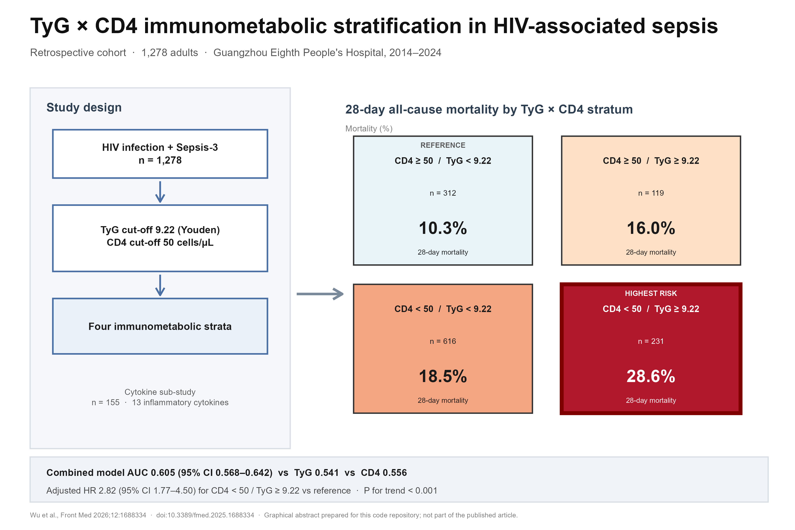

# TyG 指数与 HIV 住院患者 28 天死亡风险 · 分析代码

**Code archive — TyG index and 28-day mortality in hospitalized people with HIV**

本仓库整理了单中心 HIV 住院队列的 R 分析代码，覆盖数据合并与清洗、TyG 指数计算与分组、描述性统计、Cox / KM / RCS 生存分析、ROC / AUC / DeLong / NRI-IDI / DCA 预测评价、亚组分析与森林图、细胞因子标准化与热图，以及中介效应探索。仓库只保留代码与说明文档，**不包含任何原始数据或患者身份信息**。



*图形摘要由本仓库根据论文 Table 1 / Table 3 / Table 4 的聚合结果重绘，用于代码仓库展示；原文没有出版社正式图形摘要。来源：Wu et al., Front Med 2026;12:1688334（CC BY）。*

> [!IMPORTANT]
> **数据与隐私**
> - 本仓库**不包含任何原始数据、中间数据或患者身份信息**。`*.xlsx`、`*.xls`、`*.csv`、`*.RData`、`*.rds` 等均未收录，并已在 `.gitignore` 中屏蔽。
> - 原始数据含姓名、住院号、就诊号等可识别字段，受医院伦理审批与患者隐私限制，不能公开。
> - 数据库脚本中的明文口令已改为环境变量，请勿把真实凭据写回仓库。
> - `scripts/90_archive_mimic_2024/` 是 2024 年 MIMIC 脓毒症数据练习，**不属于论文主分析**，仅作方法参考归档。

---

## 研究背景与目的

HIV 感染者常合并代谢紊乱、慢性炎症和机会性感染，胰岛素抵抗可能是连接代谢状态与短期预后的重要环节。TyG 指数（甘油三酯-空腹血糖指数）是胰岛素抵抗的简易替代指标，但其在 HIV 住院人群中的预后价值、与 CD4 的联合分层价值仍缺乏系统评估。

本项目围绕四个问题组织代码：

1. **独立关联**：TyG 指数与 28 天全因死亡是否独立相关（三套 Cox 模型 + P for trend + RCS）。
2. **联合分层与预测增量**：TyG 与 CD4 的联合分组能否改善风险分层；联合模型相对单指标的 C-index、时间依赖 AUC、NRI / IDI、DCA 是否有增量。
3. **亚组一致性**：在不同临床亚组中效应是否一致（分层 Cox + 交互 P + 森林图）。
4. **机制探索**：TyG 与细胞因子谱、CD4 及中介路径的关系。

---

## 研究概要

| 项目 | 内容 |
|---|---|
| 研究类型 | 单中心回顾性队列研究（以论文方法学描述为准） |
| 研究对象 | HIV 住院患者，约 1300 例（以最终分析集为准） |
| 暴露 | TyG 指数 = ln[TG (mg/dL) × FPG (mg/dL) / 2] |
| 分组 | TyG 二分位 / 三分位 / 四分位；CD4 分组；TYGCD4 四分组 |
| 主要终点 | 28 天全因死亡（`d28` / `D28`） |
| 协变量 | 年龄、性别、糖尿病、高血压、CKD、肝硬化、CHD、COPD、SOFA、ART、机会性感染（马尔尼菲篮状菌、PCP、隐球菌、念珠菌）等 |
| 统计方法 | Cox 比例风险模型、KM、RCS、VIF、ROC / DeLong、时间依赖 AUC、NRI / IDI、DCA、亚组交互、中介分析 |
| 细胞因子 | C0–C7 标准曲线标准化，热图使用其中 12 项 |

---

## 发表论文

| 项目 | 内容 |
|---|---|
| 标题 | Prognostic value of combined stratification using TyG index and CD4+ T cell count for 28-day all-cause mortality risk in patients with HIV infection and sepsis: a retrospective cohort study |
| 作者 | Yongchang Wu, Jiejing Chen, Yu Meng, Mingyue Ren, Zhenyi Zou, Linghua Li, Xilong Deng, Yueping Li |
| 期刊 | *Frontiers in Medicine*, 2026;12:1688334 |
| 时间 | Received 21 Aug 2025 · Accepted 15 Dec 2025 · Published 12 Jan 2026 |
| DOI | [10.3389/fmed.2025.1688334](https://doi.org/10.3389/fmed.2025.1688334) |
| 全文 | [Frontiers 文章页面](https://www.frontiersin.org/journals/medicine/articles/10.3389/fmed.2025.1688334/full) |
| PubMed | [PMID 41601726](https://pubmed.ncbi.nlm.nih.gov/41601726/) · PMCID PMC12832338 |
| 论文许可 | CC BY 4.0（开放获取） |
| 代码许可 | Academic Non-Commercial License（见 [`LICENSE`](LICENSE)） |

---

## 相关文献（阅读导航）

> 下表为相关文献的**要点摘录**（非原文摘要全文），仅用于阅读导航；版权归原作者，DOI 链接指向出版社页面。

| 文献 | 与本研究的关联 |
|---|---|
| Rudd KE, et al. Global, regional, and national sepsis incidence and mortality, 1990–2017. *Lancet*. 2020;395:200–211. [DOI](https://doi.org/10.1016/S0140-6736%2819%2932989-7) | 全球脓毒症疾病负担与死亡规模，说明早期风险分层的公共卫生意义。 |
| Singer M, et al. The Third International Consensus Definitions for Sepsis and Septic Shock (Sepsis-3). *JAMA*. 2016;315:801–810. [DOI](https://doi.org/10.1001/jama.2016.0287) | Sepsis-3 定义（疑似感染 + SOFA ≥ 2）是本队列纳入标准的基础。 |
| Lou J, et al. A retrospective study utilized MIMIC-IV database to explore the potential association between triglyceride-glucose index and mortality in critically ill patients with sepsis. *Sci Rep*. 2024;14:24081. [DOI](https://doi.org/10.1038/s41598-024-75050-8) | 重症脓毒症中 TyG 与死亡风险相关，支持 TyG 作为代谢风险标志。 |
| Zheng R, et al. Association between triglyceride-glucose index and in-hospital mortality in critically ill patients with sepsis: analysis of the MIMIC-IV database. *Cardiovasc Diabetol*. 2023;22:307. [DOI](https://doi.org/10.1186/s12933-023-02041-w) | TyG 与脓毒症住院死亡独立相关，但单独判别能力有限，提示需要联合免疫指标。 |
| Grinspoon S, Carr A. Cardiovascular risk and body-fat abnormalities in HIV-infected adults. *N Engl J Med*. 2005;352:48–62. [DOI](https://doi.org/10.1056/NEJMra041811) | HIV 感染与体脂异常、代谢紊乱及心血管风险增加相关。 |
| Obare LM, et al. Inflammation in HIV and its impact on atherosclerotic cardiovascular disease. *Circ Res*. 2024;134:1515–1545. [DOI](https://doi.org/10.1161/CIRCRESAHA.124.323891) | 慢性炎症是 HIV 感染者“代谢-免疫轴”的核心机制之一。 |
| Non LR, Escota GV, Powderly WG. HIV and its relationship to insulin resistance and lipid abnormalities. *Transl Res*. 2017;183:41–56. [DOI](https://doi.org/10.1016/j.trsl.2016.12.007) | HIV 及 ART 相关胰岛素抵抗/血脂异常，为 TyG 的生物学基础提供支持。 |
| Boomer JS, et al. Immunosuppression in patients who die of sepsis and multiple organ failure. *JAMA*. 2011;306:2594–2605. [DOI](https://doi.org/10.1001/jama.2011.1829) | 脓毒症致死与 CD4+ T 细胞耗竭/免疫抑制相关，支持 CD4 分层的合理性。 |

---

## 代码分类

脚本按分析阶段分为 10 类，每个目录都有独立 README：

| 类别 | 目录 | 内容 | 脚本数 | 性质 |
|---|---|---|---:|---|
| 01 数据准备 | [`scripts/01_data_prep/`](scripts/01_data_prep/README.md) | 多源 Excel 合并与去重、器官障碍评分、缺失统计 | 3 | 主分析 |
| 02 TyG 指数与分组 | [`scripts/02_tyg/`](scripts/02_tyg/README.md) | TyG 计算、ROC 截断值、二分/三分/四分位分组、MI/TyG 因子 | 4 | 主分析 |
| 03 描述性分析与绘图 | [`scripts/03_descriptive/`](scripts/03_descriptive/README.md) | TyG×CD4 死亡率热图、CD4–死亡关系曲线 | 2 | 主分析 |
| 04 生存分析 | [`scripts/04_survival/`](scripts/04_survival/README.md) | VIF、Cox、KM、累积死亡、模型比较、交互、联合分析 | 7 | 主分析 |
| 05 预测性能 | [`scripts/05_prediction/`](scripts/05_prediction/README.md) | ROC/AUC/DeLong、AIC/BIC/HL、DCA、Word 报告 | 5 | 主分析 |
| 06 亚组与森林图 | [`scripts/06_subgroup/`](scripts/06_subgroup/README.md) | 分层 Cox、交互 P、肝硬化/糖尿病森林图 | 4 | 主分析 |
| 07 细胞因子 | [`scripts/07_cytokine/`](scripts/07_cytokine/README.md) | 标准化、小提琴/散点、热图、GraphPad 导出 | 4 | 主分析 |
| 08 探索性分析 | [`scripts/08_exploratory/`](scripts/08_exploratory/README.md) | TyG → CD4 → 28 天死亡的中介效应 | 1 | 探索 |
| 90 MIMIC 练习 | [`scripts/90_archive_mimic_2024/`](scripts/90_archive_mimic_2024/README.md) | 2024 年 MIMIC-IV / bdmcc 数据接入、RCS、Cox、ROC、森林图 | 15 | 归档，非论文 |
| 99 被替代/半成品 | [`scripts/99_superseded/`](scripts/99_superseded/README.md) | 旧版模型表、基础版亚组、未完成比较、半成品热图 | 4 | 仅溯源 |

完整的逐脚本索引见 [`docs/code-index.md`](docs/code-index.md)。

---

## 仓库结构

```
6-tyg/
├── README.md                       # 项目总览（本文件）
├── LICENSE                         # 学术非商业许可
├── CITATION.cff                    # 机器可读引用信息
├── packages.R                      # 依赖包一键安装
├── data/README.md                  # 数据放置说明（不含数据）
├── figures/
│   ├── README.md                   # 图片来源与复现说明
│   └── graphical-abstract.png      # 图形摘要（由 tools/ 生成）
├── docs/
│   ├── README.md                   # 文档导航
│   ├── code-index.md               # 49 个脚本的完整索引（自动生成）
│   ├── pipeline.md                 # 分析流程、依赖关系、已知问题
│   ├── input-output.md             # 每个脚本的输入/输出文件
│   ├── dependencies.md             # 生产者→消费者依赖图（自动生成）
│   ├── required-data.md            # 27 个外部输入清单（自动生成）
│   ├── data-dictionary.md          # 变量字典
│   ├── figures.md                  # 绘图脚本与图形目录
│   ├── code-review.md              # 代码审查、修复记录与复核顺序
│   ├── audit.md                    # 仓库自检报告
│   ├── notes.md                    # 相对原始工程的整理说明
│   ├── script-manifest.csv         # 机器可读脚本清单（源数据）
│   └── package-versions.csv        # 47 个包的版本快照（自动生成）
├── output/.gitkeep                 # 运行输出占位（内容不入库）
├── scripts/
│   ├── 00_setup.R                  # 数据目录与运行环境设置
│   ├── 01_data_prep/README.md
│   ├── 02_tyg/README.md
│   ├── 03_descriptive/README.md
│   ├── 04_survival/README.md
│   ├── 05_prediction/README.md
│   ├── 06_subgroup/README.md
│   ├── 07_cytokine/README.md
│   ├── 08_exploratory/README.md
│   ├── 90_archive_mimic_2024/README.md
│   └── 99_superseded/README.md
├── tools/
│   ├── build_docs.R                # 由清单生成索引/依赖/数据清单/阶段 README
│   ├── make_graphical_abstract.R   # 生成图形摘要
│   └── audit_repo.R                # 仓库自检
└── .github/workflows/r-ci.yml      # push/PR 时自动运行自检
```

---

## 分析流程

```
01_data_prep      原始表 → 合并、清洗、器官障碍评分、缺失统计 → 分析主表
      │
      ├── 02_tyg              TyG 计算、截断值、分组、MI / TyG 因子
      ├── 03_descriptive      死亡率热图、CD4–死亡关系曲线
      ├── 04_survival         VIF → Cox → KM → 累积死亡 → 模型比较 → 交互 → 联合分析
      ├── 05_prediction       ROC/AUC/DeLong → AIC/BIC/HL → DCA
      ├── 06_subgroup         分层 Cox → 交互 P → 森林图
      ├── 07_cytokine         标准化 → 小提琴图 → 热图 → GraphPad 导出
      └── 08_exploratory      中介效应
```

**关键依赖**：

- `04_survival/10-cox交互.R` 在会话中生成 `hiv_pos`，`04_survival/11-联合分析.R` 直接使用它，两者必须在同一 R 会话中按顺序运行。
- `90_archive_mimic_2024/` 的数据库与合并脚本全程依赖内存对象，不能单独复现。
- `02_tyg/4-tyg因子开发.R` 读取的 `MI_2.0.xlsx` 在仓库内没有生成脚本。
- 部分脚本（`02_tyg/2-四分位间距.R`、`04_survival/7-累计死亡率.R`、`08_exploratory/9-跑通中介效应.R`、`05_prediction/AUC-ROC.R`）直接使用会话内对象，不能独立运行。

完整的阶段说明见 [`docs/pipeline.md`](docs/pipeline.md)，文件级依赖见 [`docs/dependencies.md`](docs/dependencies.md)。

---

## 绘图代码

所有图形均由脚本生成，仓库不收录图片。图与脚本的对应关系见 [`docs/figures.md`](docs/figures.md)，主要包括：

| 图形 | 脚本 |
|---|---|
| TyG × CD4 四格死亡率热图 | `scripts/03_descriptive/tyg热图绘制.R` |
| 28 天 KM 曲线 | `scripts/04_survival/6-KM1.R` |
| 累积死亡曲线 | `scripts/04_survival/7-累计死亡率.R` |
| TyG 截断值 ROC | `scripts/02_tyg/1-计算tyg.R` |
| 多模型 ROC / 校准曲线 | `scripts/05_prediction/AUC-ROC.R`、`18-auc比较.R` |
| 决策曲线 DCA | `scripts/05_prediction/15-DCA-决策曲线.R` |
| 亚组森林图 | `scripts/06_subgroup/19-森林图.R`、`19-森林图绘制-子项.R` |
| 细胞因子热图 / 小提琴图 | `scripts/07_cytokine/16-细胞因子热图绘制.R`、`2-细胞因子散点图绘制.R` |
| RCS 曲线（MIMIC 练习） | `scripts/90_archive_mimic_2024/7-26-Rcs曲线.R`、`7-29-RCS.R` |

---

## 运行环境

- **R 4.4.0**（开发与运行环境），RStudio
- 主要依赖见 [`packages.R`](packages.R)：`tidyverse`、`readxl`、`writexl`、`openxlsx`、`survival`、`survminer`、`rms`、`maxstat`、`timeROC`、`survcomp`、`survIDINRI`、`nricens`、`pROC`、`caret`、`ResourceSelection`、`rmda`、`ggplot2`、`ggpubr`、`ggtext`、`pheatmap`、`forestplot`、`flextable`、`officer` 等
- 已从 CRAN 归档的包（`plotRCS`、`rmda`）安装方式见 `packages.R` 注释
- 47 个包的版本与使用脚本数见 [`docs/package-versions.csv`](docs/package-versions.csv)

```r
# 一键安装
source("packages.R")
```

---

## 运行方式

1. **准备数据目录**：把所有输入 Excel 表放在同一个目录，文件名与脚本中的字面量一致（清单见 [`data/README.md`](data/README.md) 与 [`docs/required-data.md`](docs/required-data.md)）。

2. **设置数据目录**（推荐用环境变量，避免改代码）：

   ```powershell
   # Windows PowerShell
   $env:TYG_DATA_DIR = "D:/tyg-data"
   ```

   ```bash
   # macOS / Linux
   export TYG_DATA_DIR=/path/to/tyg-data
   ```

   仓库中的脚本已统一改成：

   ```r
   setwd(Sys.getenv("TYG_DATA_DIR", unset = "D:/Desktop"))
   ```

   即：未设置环境变量时，仍沿用原作者的 `D:/Desktop`；设置后即可指向任意数据目录。少数原本指向 `D:/Desktop/肝衰竭` 或 `D:/Desktop/Cursor` 的脚本，默认值保留原路径，设置环境变量后同样会统一覆盖。

3. **按顺序运行**：先看 [`docs/pipeline.md`](docs/pipeline.md)。脚本之间存在先后依赖（前一步的 `write_xlsx` 是后一步的 `read_excel`），输出默认写回当前工作目录。

4. **注意**：
   - 脚本文件名中的编号是作者原始工作顺序，存在重复编号（两个 `13-`、两个 `19-`、两个 `17-` 等），表示同一阶段的不同迭代版本。
   - 部分脚本是探索性草稿，可能读取已不存在的中间表；[`docs/input-output.md`](docs/input-output.md) 列出了每个脚本实际读写的文件名，可据此核对。
   - 中文文件名与中文注释保持原样，便于与原始分析记录对应。

---

## 代码质量与自检

本轮按正式代码仓库标准做了系统整理，并提供可重复运行的检查：

| 检查项 | 结果 |
|---|---|
| 清单脚本数 vs `scripts/` 脚本数 | 49 / 49 |
| `parse()` 语法检查 | 54 个 R 文件，0 失败 |
| Git 跟踪数据文件 | 0 |
| 明文凭据 | 0 |
| 硬编码 `setwd("...")` | 0 |
| 阶段目录 README | 10 / 10 |
| 仓库自检结论 | **PASS** |

```bash
# 重新生成索引/依赖/数据清单/阶段 README
Rscript tools/build_docs.R

# 仓库自检
Rscript tools/audit_repo.R
```

GitHub Actions 会在每次 push / PR 时运行同一自检（`.github/workflows/r-ci.yml`）。详细的修复清单与仍需人工确认的问题见 [`docs/code-review.md`](docs/code-review.md)，自检结果见 [`docs/audit.md`](docs/audit.md)。

> **重要**：本轮修复了若干明确缺陷（如热图整列求和、TyG3 被覆盖、TyGbmi4 切点、P for trend 结局口径、AUC 索引等），**部分数值会与修复前不同**。重跑后请与论文/原始结果逐项核对；原文件已在本地另行备份（未入库）。

---

## 已知限制

- 本仓库不含数据，未做运行时回归测试；`parse()` 与自检不能替代真实数据上的验证。
- `04_survival/11-联合分析.R` 依赖 `10-cox交互.R` 的会话对象，不是独立脚本。
- `02_tyg/4-tyg因子开发.R` 的上游 `MI_2.0.xlsx` 没有生成脚本。
- 两个 `06_subgroup/19-森林图*.R` 中的 N / HR / CI / P 为手工写死，正式复用前必须用最新结果替换。
- 细胞因子散点图与热图使用两版不同的标准化结果（`标准化样本1.xlsx` vs `标准化样本-0729.xlsx`）。
- `14.xlsx` 被 3 个脚本写入，存在覆盖风险；为兼容原流程未改名。
- 2024 MIMIC 归档脚本大量依赖会话内存对象，不能独立复现。

详见 [`docs/code-review.md`](docs/code-review.md) 与 [`docs/pipeline.md`](docs/pipeline.md)。

---

## 数据可用性

受医院伦理审批与患者隐私限制，原始数据与个体级中间数据不能公开。如需合作或数据申请，请联系研究负责人。

## 引用与许可

- **引用**：如使用本代码，请引用相关论文与本仓库；机器可读的引用信息见 [`CITATION.cff`](CITATION.cff)（含论文的 `preferred-citation`）。
- **许可**：本仓库采用 **Academic Research License (Non-Commercial)**，详见 [`LICENSE`](LICENSE)。允许非商业学术研究、教学与复现；商业使用需事先取得书面许可。
- **数据**：本许可不涵盖任何患者级数据；原始数据不在仓库中，数据使用受独立伦理审批与数据使用协议约束。

**论文引用（BibTeX）**

```bibtex
@article{wu2026tyg,
  title   = {Prognostic value of combined stratification using TyG index and CD4+ T cell
             count for 28-day all-cause mortality risk in patients with HIV infection and
             sepsis: a retrospective cohort study},
  author  = {Wu, Yongchang and Chen, Jiejing and Meng, Yu and Ren, Mingyue and
             Zou, Zhenyi and Li, Linghua and Deng, Xilong and Li, Yueping},
  journal = {Frontiers in Medicine},
  volume  = {12},
  pages   = {1688334},
  year    = {2026},
  doi     = {10.3389/fmed.2025.1688334}
}
```

---

## English summary

This repository contains the R analysis code for a single-centre retrospective cohort study evaluating the association between the triglyceride-glucose (TyG) index and 28-day mortality in hospitalized people with HIV. It covers data harmonisation, TyG derivation and grouping, descriptive analyses, Cox / Kaplan–Meier / restricted cubic spline models, ROC / AUC / DeLong / NRI-IDI / decision-curve analyses, subgroup and forest plots, and cytokine standardisation and visualisation. Raw data and patient-level information are **not** included for privacy reasons. The `scripts/90_archive_mimic_2024/` folder contains unrelated 2024 MIMIC-IV sepsis practice code kept for reference only.

---

## 整理记录

- 2026-10-21：从本地工程 `6-tyg` 整理为纯代码仓库，共 49 个分析脚本 + `scripts/00_setup.R`；未收录任何数据文件。整理前的完整备份已在本地另行保存（未入库）。
- 2026-10-21（第二轮）：补齐 10 个阶段 README、49 条脚本清单、依赖图、27 个外部输入清单、47 个包版本快照、变量字典、代码审查、自检脚本与 GitHub Actions；修复明确代码缺陷并记录。详细改动见 [`docs/notes.md`](docs/notes.md) 与 [`docs/code-review.md`](docs/code-review.md)。
- 2026-10-21（第三轮）：添加发表论文信息与 Frontiers 页面链接、相关文献阅读导航、图形摘要（[`figures/graphical-abstract.png`](figures/graphical-abstract.png)，由 `tools/make_graphical_abstract.R` 生成）、BibTeX 与 `CITATION.cff` 的 `preferred-citation`；版本标记为 `v1.2.0`。
